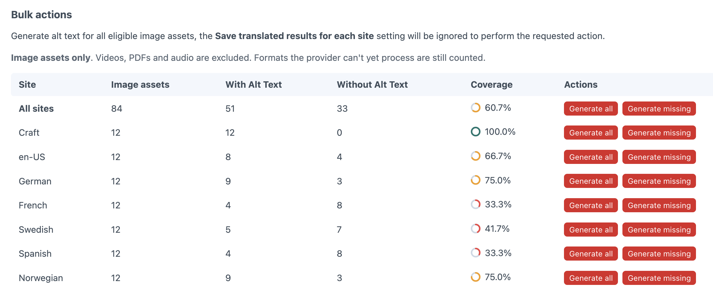
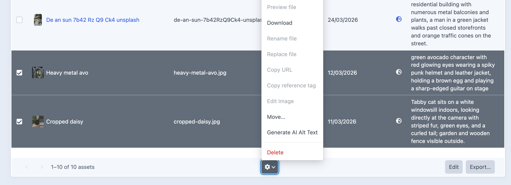
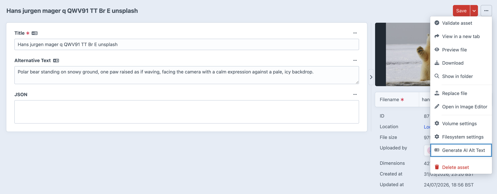

# 🤖 💬 AI Alt Text
  
Generate alt text for CraftCMS Asset Images using the Anthropic, OpenAI, Langdock or OpenRouter API (Anthropic or OpenAI models only through Langdock and OpenRouter).

🚨 NEW Additional AI Provider support for OpenRouter is now available.

[Plugin Store](https://plugins.craftcms.com/ai-alt-text?craft5) | [GitHub Repository](https://github.com/heavymetalavo/craft-aialttext)

## 🎬 Video walkthrough

A full walkthrough of all plugin features - [watch on YouTube](https://youtu.be/Kp0OQVfd4iw):

[](https://youtu.be/Kp0OQVfd4iw)

## 📋 Requirements

This plugin requires: 
- Craft CMS 5.0.0 or later - running Craft 4? [Use the 4.x branch](https://github.com/heavymetalavo/craft-aialttext/blob/4.x/README.md) instead
- PHP 8.2 or later
- An Anthropic, OpenAI, Langdock or OpenRouter API key

## 📥 Installation

You can install this plugin from [the Plugin Store](https://plugins.craftcms.com/ai-alt-text?craft5) or with Composer.

### 📦 With Composer

Open your terminal and run the following commands:

```sh
# tell Composer to load the plugin
composer require heavymetalavo/craft-aialttext
# or
ddev composer require heavymetalavo/craft-aialttext
```

Then:

```sh
# tell Craft to install the plugin
./craft plugin/install ai-alt-text
# or
ddev craft plugin/install ai-alt-text
```

## 🤖 Setup API Keys

### Anthropic

1. Visit [https://console.anthropic.com/](https://console.anthropic.com/) and [sign up](https://console.anthropic.com/).
2. Navigate to **Settings → API Keys**.
3. Create a new API key and save it to an environment variable (`.env`).
4. Ensure you have credits in your account under **Billing**.

### Langdock

1. In [Langdock](https://langdock.com/), click your account name (bottom left), then go to **Settings → Products → API**. On the **Workspace API keys** tab tick only **Completion API**, which covers both the OpenAI and Anthropic endpoints this plugin uses (see the [Completion API overview](https://docs.langdock.com/en/developer/completion-api/completion-overview)), then click **Create API key**. Creating a workspace key needs a workspace admin. The **Personal API keys** tab on the same page also works, see [Personal API keys](https://docs.langdock.com/en/using-langdock/account/personal-api-keys).
2. Copy the new key and save it to an environment variable (`.env`).
3. Choose the **Model Family** that matches the model you want to use: `Claude (Anthropic API)` for Claude models, `GPT (OpenAI API)` for GPT models. Both use the same API key.

Requests go to Langdock's EU region, where Langdock hosts its OpenAI and Anthropic models. Dedicated Langdock deployments are not supported yet: requests always go to `api.langdock.com`.

### OpenRouter

1. Visit [https://openrouter.ai/](https://openrouter.ai/) and sign up or log in.
2. Make sure your account has some credit, a few dollars goes a long way with the small models.
3. Go to [Keys](https://openrouter.ai/keys), create a key, and give it a name and, if you like, a credit limit.
4. Copy the key and save it to an environment variable (`.env`).
5. Set the **Model** to the model's OpenRouter name, which starts with the vendor, e.g. `anthropic/claude-haiku-5.5` or `openai/gpt-6-luna` (see [OpenRouter models](#-openrouter-models) for how to find ones that accept images, and what they cost).

OpenRouter takes the same request for every model, so there is no model family to choose and any model that accepts image input can be used. The plugin is built for and tested with OpenAI and Anthropic models. Other vendors' models aren't supported, but [the ones tested](#-openrouter-models) worked unchanged, and how good the alt text is varies between models. Worth knowing:

- Some models think before they answer and are slow (Grok 4.6 and Mistral Large took over 40 seconds), so raise the request timeout in `config/guzzle.php` if you see a timeout error.
- A provider sometimes rate-limits a model for a moment ("temporarily rate-limited upstream"), and failed jobs can be retried from the queue.
- A few models need a setting in your OpenRouter account, and the error says which and links to it.

### OpenAI

1. Visit [https://platform.openai.com/](https://platform.openai.com/) and [sign up](https://platform.openai.com/signup) in the top-right.
2. Revisit [the API platform home page](https://platform.openai.com/) again
3. Click the ⚙️ icon in the top-right
4. Left menu > Organization > API keys > + Create new secret key (top-right)
5. Create a name and assign to a suitable project
6. Permissions > Restricted > set "Model capabilities" to "Write" and "Responses API" to "Write"
7. Save API key to an env var, you wont get to see it again!
8. Make sure you have a credit balance! Left menu > Organization > Billing, loading $5 is probably going to get you quite far, disabling auto recharge might be safer though that's up to you!

## 🚀 How to use

1. Check the plugin settings are suitable for your project (and your API key is added)
2. Ensure your volumes have the native `alt` field assigned to the field layout
3. Ensure your templates are updated to use the `alt` field, you could consider a fallback `asset.alt ?: asset.title` if that what was used before
4. Then generate some AI Alt text by performing one of the following actions:
    1. Triggering a bulk action in the bulk actions table
    2. For individual or a group of specific assets find them in the <strong>Assets</strong> manager section</a> clicking the checkbox on a row, clicking the cog icon to reveal the Element actions menu and select <strong>Generate AI Alt Text</strong>
    3. When viewing a single asset's page, open the action menu and select <strong>Generate AI Alt Text</strong>
    4. Upload a new asset (if the upload setting is enabled)
5. A single asset, selected in the **Assets** manager or on its own page, is generated straight away. Multiple selected assets, the bulk actions, new uploads, and the other sites when **Save translated results for each site** is enabled are queued as jobs instead







Example twig:

```twig


```

## 🖥️ Console Commands

**Important**: `missing` and `all` create **queue** jobs which when run will generate the alt text, while `single` generates straight away (queueing the other sites when **Save translated results for each site** is enabled). By default, all commands process **all sites** unless `--site-id` is specified.

### Available Commands

| Command | Description |
|---------|-------------|
| `ai-alt-text/generate/stats` | Show alt text coverage statistics |
| `ai-alt-text/generate/missing` | Queue jobs for assets without alt text (recommended) |
| `ai-alt-text/generate/all` | Queue jobs for ALL assets (⚠️ overwrites existing alt text) |
| `ai-alt-text/generate/single <id>` | Generate for a specific asset ID straight away (use `-s` for one site) |

### Options

| Option | Alias | Description | Default |
|--------|-------|-------------|---------|
| `--site-id=<id>` | `-s` | Process only specific site (if not set, processes all sites) | * |
| `--batch-size=<n>` | `-b` | Assets per batch (memory efficiency) | `500` |
| `--verbose` | `-v` | Show detailed progress | `false` |
| `--force` | `-f` | Skip confirmations | `false` |

### Examples

```sh
# Check coverage across all sites
./craft ai-alt-text/generate/stats

# Queue missing alt text for all sites
./craft ai-alt-text/generate/missing

# Queue for specific site with verbose output
./craft ai-alt-text/generate/missing --site-id=2 --verbose

# Generate for a single asset
./craft ai-alt-text/generate/single 123

# Generate for a single asset on a specific site
./craft ai-alt-text/generate/single 123 --site-id=2
```

## ⚙️ Plugin settings

After installation, configure the plugin at **Settings → AI Alt Text**:

### 📊 Settings overview

| Setting | Description |
|---------|-------------|
| **AI Provider** | Choose between OpenAI, Anthropic, Langdock or OpenRouter. |
| **OpenAI/Anthropic/Langdock/OpenRouter API Key** | Your provider's API key. |
| **Model** | The AI model to use (e.g., `gpt-6-luna` or `claude-haiku-5-5`). For Langdock, use the model's name in Langdock. For OpenRouter, use its OpenRouter name, e.g. `anthropic/claude-haiku-5.5` or `openai/gpt-6-luna`. |
| **Langdock Model Family** | Langdock only. `Claude (Anthropic API)` or `GPT (OpenAI API)`. It must match the model, and decides which of Langdock's compatible APIs requests are sent to. |
| **Langdock Image Detail Level** | Langdock with the `GPT (OpenAI API)` model family only. Works like the OpenAI image detail level, `low`, `high` or `auto`. |
| **Langdock Reasoning Effort** | Langdock with the `GPT (OpenAI API)` model family only. Works like **OpenAI Reasoning Effort**, see [the options below](#-openai-reasoning-effort-options). |
| **OpenRouter Image Detail Level** | OpenRouter only. Works like the OpenAI image detail level, `low`, `high`, `original` or `auto`. Only OpenAI models use it. |
| **OpenRouter Reasoning Effort** | OpenRouter only. Works like **OpenAI Reasoning Effort**, see [the options below](#-openai-reasoning-effort-options). Only sent to OpenAI reasoning models. |
| **Detail Level**| How detailed the image analysis should be (controls resolution/scaling). |
| **OpenAI Reasoning Effort**| The reasoning effort level for OpenAI reasoning models. |
| **Prompt** | The instructions sent to the AI provider as the system / instruction message (example [below](#default-prompt)). Supports `{asset.property}` and `{site.property}` variables, plus `{site.languageName}` for the language's display name (e.g. `English (United Kingdom)`). |
| **Propagate** | Whether the asset should be saved across all of its supported sites, if enabled it could save the same initial alt text value across all sites. |
| **Generate for new image assets (on upload or file replacement)** | Automatically generate alt text when new assets are created, or when an asset's file is replaced. On replacement, the alt text for the site the replacement was made in is overwritten, since it describes the old image; other sites keep their existing alt text unless **Save translated results for each site** is enabled. |
| **Process SVGs** | Attempt to generate alt text for SVG files when they are uploaded or batched processed. |
| **Save translated results for each site** | Save translated results to translatable fields for each site. |

#### 🧠 Model Options

All vision models should work, these small models seem to hit the sweetspot between quality & cost:
- `claude-haiku-5-5` - For Anthropic: the fastest and most cost-efficient Claude model
- `gpt-6-luna` - For OpenAI: "Our most efficient model for focused, high-volume tasks"

To find out which models are capable of vision, check [the models page](https://platform.openai.com/docs/models), click into a model's detail page (e.g., [gpt-6-luna](https://platform.openai.com/docs/models/gpt-6-luna)) and look for "**Input**: Text, image" in the features columns at the top.

#### 🌐 OpenRouter models

The plugin doesn't keep a list of vision models, since OpenRouter's catalogue changes every week, but the models below all worked when tested.

**Check that a model accepts images**
- Open the [models page filtered to image input and text output](https://openrouter.ai/models?input_modalities=image&output_modalities=text). Every model listed can be used, and a model's own page shows the input modalities it accepts. Models on the page's *Image* tab generate images and return no text, so they can't write alt text.
- Or ask the API, which needs no key: `curl -s 'https://openrouter.ai/api/v1/models?input_modalities=image' | jq -r '.data[].id'` prints the ids to use as the **Model**.
- A model that can't read images is refused with "No endpoints found that support image input".

**Cheapest and best value**

Measured on one small test photo at `low` detail (OpenRouter's prices on 15 October 2026, the cost of the request OpenRouter reports):
- **Cheapest:** `google/gemma-3-4b-it` (about $0.00002 per alt text) and `nex-agi/nex-n2.5-mini` (about $0.00005). Both are small models and their wording was less natural.
- **Best value:** `openai/gpt-6-luna` at about $0.00005 and 2 seconds, and `anthropic/claude-haiku-5.5` at about $0.00025 and 2.5 seconds, both with good alt text. Haiku costs the same per token as Luna but counted six times as many tokens for the image (2,233 against 349), which is why it comes out about five times dearer here.
- **Not as cheap as it looks:** `deepseek/deepseek-v4.1-flash` has the lowest price per input token ($0.016 per million) but thinks before it answers. The 1,000 to 2,400 tokens it spends per image are billed as output, so each alt text cost $0.0006 to $0.0016 (10 to 30 times Luna) and took 7 to 12 seconds. The **Reasoning Effort** setting doesn't reach it, as it's sent to OpenAI models only.

The cost of an image depends on its size and on how each model counts image tokens, so check the *Activity* page in OpenRouter after a few runs with your own images.

**Models tested**

Each was given the same photo and prompt through the plugin on 15 October 2026. Models not listed in the first row were not tried.

| Vendor | Worked | Notes |
|---|---|---|
| OpenAI | `gpt-6-luna`, `gpt-5-nano`, `gpt-4o-mini` | |
| Anthropic | `claude-haiku-5.5` | |
| Google | `gemini-4-argon`, `gemini-3.8-flash`, `gemini-2.5-flash-lite`, `gemma-3-4b-it` | `gemini-nano-banana-2.1` generates images and failed. |
| Meta | `muse-spark-open`, `muse-spark-1.3` | About 14 seconds each. `meta-llama/llama-guard-4-12b` is a safety model and only answers "safe". |
| xAI | `grok-4.7`, `grok-4.5`, `grok-4.6` | `grok-4.6` took 67 seconds, and `grok-build-0.1` timed out after 40. |
| DeepSeek | `deepseek-v4.1-flash`, `deepseek-v4-flash-vision-exp` | See the cost note above. |
| Mistral | `mistral-large-4-0`, `mistral-medium-3-5`, `mistral-small-3.2-24b-instruct` | `mistral-large-4-0` took 41 seconds. `mistral-small-2603` was rate-limited upstream when tried. |
| Qwen | `qwen3.8-flash`, `qwen3.8-omni-flash`, `qwen3.8-max-0902` | `qwen3.7-flash` took 45 to 52 seconds. |
| Others | `amazon/nova-lite-v1`, `nvidia/nemotron-3.5-super-vl`, `z-ai/glm-5.3-flash`, `moonshotai/kimi-k3`, `cohere/command-a-plus`, `stepfun/step-3.7-flash`, `xiaomi/mimo-v2.6-flash`, `bytedance-seed/seed-1.6-flash`, `thinkingmachines/inkling-small`, `perplexity/sonar`, `perceptron/perceptron-mk1.5` | `rekaai/reka-edge`, `bytedance/ui-tars-1.5-7b` and `prism-ml/ternary-bonsai-2-27b` returned garbled text. |

Failures that weren't about the model: `meta/muse-spark-1.3-contributor` and `sakana/sakana-namazu` were blocked by the data policy in my OpenRouter account (the error links to your [privacy settings](https://openrouter.ai/settings/privacy)), `minimax/minimax-01` rejects the plugin's maximum output length, and `scaledown/extract` needs options of its own.

#### 💬 Default prompt

This is sent to the provider as the system / instruction message (Anthropic `system`, OpenAI `instructions`); the image is sent in the user turn with a short trigger. `{site.languageName}` resolves to the language's display name and `{site.language}` to its BCP 47 language tag (e.g. `en-GB`), so the default pairs them - edit the parenthesised format freely.

> Describe the image provided (roughly 150 characters). The output MUST be suitable for use directly as an HTML alt attribute value. Consider transparency within the image if supported by the file type, e.g. don't suggest it has a dark background if it is transparent. When describing a person do not assume their gender. Do not add a prefix of any kind (e.g. "#", "alt text:", "An image of", "A photo of"). Do not wrap the output in quotes. Output in the language: {site.languageName} (BCP 47: {site.language})

#### 🔍 Image detail options

**OpenAI:**
- `low` - Fast, low-cost (512px x 512px) (default)
- `high` - Standard high-fidelity understanding
- `original` - Large, dense, spatially sensitive images (gpt-5.4+)
- `auto` - Let the model choose

**Anthropic:**
- `low` - 500px x 500px (recommended default)
- `medium` - 1000px x 1000px
- `high` - 1568px x 1568px

#### 🧠 OpenAI Reasoning Effort options

Controls how much time the model spends "thinking" before generating a response (only applicable to OpenAI reasoning models like `o*` (e.g. `o1`) and `gpt-5*`). The default is `low`.
- `none`
- `minimal`
- `low`
- `medium`
- `high`
- `xhigh`

**Langdock** with the `Claude (Anthropic API)` model family has no image detail setting: images are scaled to the `low` size (500px x 500px) and always sent as base64, since Langdock does not accept image URLs. With the `GPT (OpenAI API)` model family, **Langdock Image Detail Level** (`low`, `high` or `auto`) and **Langdock Reasoning Effort** work like the OpenAI settings above (both default to `low`).

**OpenRouter** always sends images as base64 and scales them as OpenAI does, whichever model is used. OpenAI models use **OpenRouter Image Detail Level** and **OpenRouter Reasoning Effort** (both default to `low`). Claude and other models are sent neither, and so use their own defaults.

For more information, refer to the [OpenAI](https://platform.openai.com/docs/guides/images) and [Anthropic](https://docs.anthropic.com/en/docs/build-with-claude/vision) documentation.

## 🔐 Permissions

Bulk generation is gated by the **AI Alt Text Bulk Actions** utility permission, which Craft registers automatically for the plugin's utility. Grant it to the relevant user groups under **Settings → Users → (group or user) → Permissions → Utilities** after installing. Admins always have it. One checkbox covers viewing the utility and running its "Generate all" / "Generate missing" actions.

Generating for a single asset doesn't have its own permission - it's available to anyone who can save the asset in question (for assets uploaded by other users this requires the "Save assets uploaded by other users" volume permission, matching what they could edit manually). Automatic generation on upload or file replacement is controlled by the "Generate for new image assets" setting alone.

## 🏷️ Field requirements

This plugin requires a native CraftCMS field for alt text with the handle `alt` to be added to all asset volumes where you want to generate alt text. The plugin will use this field to store the generated alt text.

To add this field:
1. Go to **Settings → Assets → Volume name → + Add → search for the `alt` field and click → save**
2. Scroll to Field Layout section
3. Click the `+ Add` button
4. Search for the `alt` field and click 
5. Save changes to the volume
6. Update your templates to use the new `alt` field

### Provider-Specific Limits

- **Automatic Scaling**: The plugin automatically detects when an image exceeds provider limits and applies transforms (resizing or quality reduction) before sending the payload.
- **Supported file types**: Both AI providers support: `png`, `jpeg`, `jpg`, `webp`, `gif` (non-animated)
- **SVG Support**: SVGs are rasterized to PNG (preserving transparency) before being sent to the AI (where transformSvgs is enabled).
- **AVIF, HEIC & HEIF Support**: These image types are converted to PNG before being sent to an AI provider. This requires an image driver (ImageMagick built with AVIF/HEIF/HEIC support) that can decode them on environments without that support these assets are skipped.
- **Animated GIFs**: Only the first frame is processed.
- **Private Assets**: Assets on private volumes without public URLs can be sent as base64 encoded strings. Retrieving an image transform's file contents is not currently supported by CraftCMS. Meaning that for file types not supported by an AI provider (e.g. an SVG files) it is not possible to generate alt text for these private assets.
- **Servd/Cloud**: Support for specialized asset bundles (like Servd) depends on the environment's ability to handle raster transforms.
- **Consider AI Provider level boundaries**: e.g. OpenAI: "No watermarks or logos - No NSFW content - Clear enough for a human to understand"

## Oddities, Logic & Limitations

- The OpenAI API has [image input requirements](https://platform.openai.com/docs/guides/images-vision?api-mode=responses#image-input-requirements) which over the lifespan of this plugin have changed without notice, the requirements are not always enforced, e.g. base64 encoded images above the required image dimensions have been accepted by the API.
- Craft CMS uses the [Imagine library](https://github.com/php-imagine/Imagine) for image processing, which can only transform [select image formats](https://github.com/php-imagine/Imagine/blob/develop/src/Image/Format.php#L14-L32). Support for these formats may vary depending on what ImageMagick drivers are available in your environment. If a source image is in a supported format, the plugin will generate a transform in one of the supported file types to send to the OpenAI API.
- Where an unsupported file type is requested the plugin will attempt an image transform to a jpg to be sent instead
- The plugin checks a file's mimetype to see if it's valid, or if it needs a format conversion before sending to the API
- If an asset's dimensions are larger than the dimensions required by the API an image transform is sent instead
- If an asset has no URL (private) and requires a transform (e.g. if the original asset is an unsupported mime type, or, the dimensions are too large), Craft may be unable to retrieve the transform's file contents for base64 encoding. In that case the plugin will not fall back to sending the original source file unless its MIME type is natively accepted by the AI provider.
- Where an alternative image transformer is used, e.g. when an application is hosted on [Servd](https://servd.host) and assets are processed through their asset platform this may not support svg -> raster transforms

## 🛠️ Troubleshooting

- If the plugin returns errors about API authentication, verify your API key.
- For "bad request" errors, ensure your selected model supports vision capabilities.
- Alt text generation is processed through Craft's queue system for bulk operations, so check the queue if generation seems to be taking a long time.
- Any errors _should_ be logged, check your queue.log files!
- Check the asset has a title! If somehow an asset exists without one craft will not be able to resave it.

## ⚠️ Disclaimer

We've taken some steps to try prevent unexpected costs with default plugin settings (e.g. detail: `low` and the suggested small model `gpt-6-luna`) though we take no responsibility for excessive API token usage that may result from mistakes, bugs, or security vulnerabilities within this plugin so use at your own risk.

If you are concerned about unexpected charges we recommend:
- Set up rate limits and spending caps at the API account level in your [OpenAI account settings](https://platform.openai.com/account/billing/limits)
- Start with smaller batches when using bulk generation until you're comfortable with the costs
- Consider using the default `low` setting, which significantly reduces token usage
- Monitor your OpenAI API usage regularly

### 📈 Example usage statistics

When testing with OpenAI using the default settings (`gpt-4o-mini` model, `low` detail level):

| Metric | Value |
|--------|-------|
| March budget | $0.03 / $120 |
| Total tokens used | 163,713 |
| Total requests | 29 |

## 🙋 Support

If you encounter any issues or have questions, please submit them on [GitHub](https://github.com/heavymetalavo/craft-aialttext/issues).

## Credits

The eye icon used in this project is from [SVG Repo](https://www.svgrepo.com/svg/193488/eye) and is available under the CC0 1.0 Universal (Public Domain) license.
